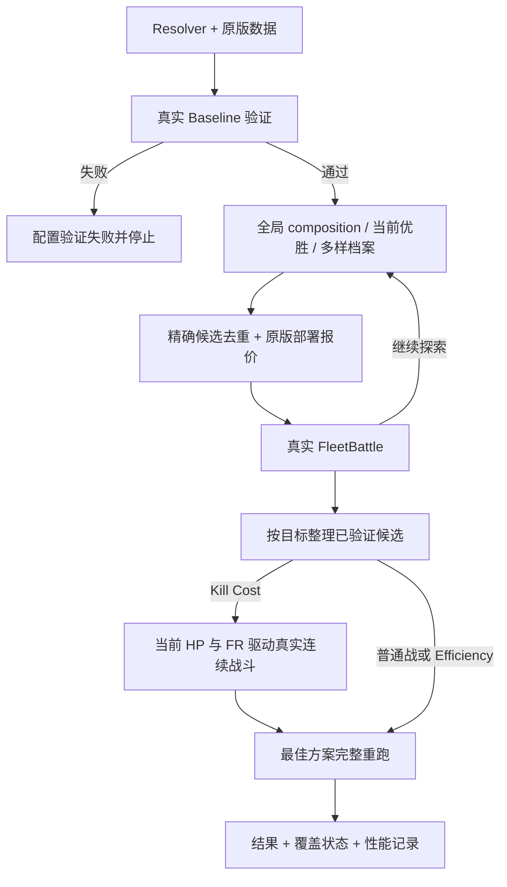

# Fleet Optimizer v3：实际目标、搜索覆盖与五分钟预算

硬件：Intel Core i7-10750H，6 核 / 12 线程，约 24 GiB 内存，Windows。

本报告对应 2026-09-13–14 本地 Godot 4.7.2 / recovered game 0.85.1.0。日常入口为 `poc/fleet_optimizer_search.gd`；原版战斗代码位于隔离的 `work/full_recovered`，不涉及 Steam 安装和正式存档。

2026-09-26 语义更新：日常 v3 的 `kill_cost` 将输入 FR 解释为每次部署上限，每场恢复相同上限，击杀总成本可超过输入 FR。另保留 `affordable_kill_cost` 作为第三种 Boss 策略：按当前钱包逐场支付，且累计实际 Used FR 不超过输入 FR。两种击杀模式均保存单次部署与当前资源两个独立候选，后者未验证成功时明确显示“未找到可负担的完整击杀”。预算不足时保留并重放单场有效 Baseline，不把基线当成已验证的完整击杀。下文旧版当前余额、原版账本及历史基准保留为当时实验记录；当前契约以 README 和代码为准。

部署报价现可复用原版场景观测的装配单组成本，按原版逐组 Overdeploy 算法计算不同数量的 committed FR；未知成本仍建原版场景。此项只减少报价建场景，不改变战斗模拟或候选剪枝条件。

## A. 原算法分析

旧版先枚举 composition/loadout 并调用原版部署报价，再 Probe 代表阵型、Fleet/Position Beam、局部和小空间精确搜索，最后重跑及 Boss refinement。日常 Fast 的前置 composition 预算很小：本次实测只有 21 次报价（含 Baseline），约 20 个舰队进入后续搜索。预算在 materialization 之前截断，后续局部搜索无法恢复遗漏舰队。

这比 Beam 宽度本身更影响覆盖。Baseline WIN 附近可能有离散的 LOSS 障碍；相同 composition 仅改变位置就能反转胜负。旧版将 Boss 的正常 LOSS 导入 Recovery，并在 Efficiency 输出中要求击杀 refinement：实际测得正效率，却输出 NO WIN FOUND。普通战底层 Used FR 排序本来正确，问题在候选覆盖与流程目标。

性能瓶颈是原版场景创建、setup、battle_start 和物理模拟。旧 B13 平均每场：创建 577 ms、setup 99 ms、start 395 ms、实际 battle 197 ms、cleanup 15 ms；额外原版报价平均 1166 ms。旧 B12 实际 battle 均值 1249 ms，说明节点与候选差异很大。旧“生成”阶段 22.6–27.1 秒主要包含串行报价，不能当成纯枚举成本。JSON 序列化只需几十毫秒，不是主要瓶颈。

保留：原版部署报价、原版 FleetBattle 模拟、真实 Used FR/效率排序、舰种级 loadout、唯一格子枚举、精确候选缓存、原有 worker IPC 服务。保留移动/交换/删舰/换舰作为产生候选的方法，不把结果当单调性证明。

替换：日常的 Beam/Probe 阶段、前置 composition 截断、Smart Prune、Recovery、Efficiency 对 Kill refinement 的依赖。旧 retention 下界不适用于免费友军增援可能产生的退款，不能安全用于新流程。旧代码作为服务及历史回归保留，日常入口不调用这些剪枝流程。

## B. 新搜索流程



1. Resolver 仍读取真实 FleetEvent、Fleet battle、Hazard、Support 和玩家状态。Baseline 必须启用并通过真实战斗；普通战要求 victory，Boss 要求 damage > 0。失败输出配置与 simulated result，worker 不启动，无 Recovery。
2. 快速生成所有 composition 描述，按总组数与舰种集合分桶、随机轮转。四种标准舰、十格、每种 0–10 的配置有 1000 个非空 composition；日常 Mod 集合对应 465,905,660 个位置/loadout 组合。枚举描述只需约 40 ms，不会因前 20 个报价耗尽预算而永久丢掉其余描述。
3. 交错调度三类候选：Fast 以 25% 全局、50% 当前优胜方案、25% 多样档案的尝试次数分配；Balanced 为 40%/30%/30%。全局候选不使用 Baseline 距离，按 composition 轮转选择 Mod 和全局随机位置。比例是调度尝试比例，不保证相同比例的时间或实际模拟数。
4. 当前优胜方案与最多 32 个 composition/loadout 档案使用有限、打乱后轮转的变体桶：单舰删除、单舰替换、同舰种双舰替换、舰种级 Mod 变更、移动/交换/镜像、增加舰船。桶用尽后继续全局位置跳转。档案允许保留 LOSS，不因一次失败否定整个舰队。
5. 对实际 materialized 候选使用原版成本和部署报价检查资源可行性，然后真实 FleetBattle。缓存键保留精确位置、舰种、Mod、第三槽顺序、difficulty override 和完整环境浮点值。原版按格子启动部署，因此固定格子后的输入数组顺序可以合并；不同格子、Mod 或支持配置不能合并。仅部署报价可按舰种数量及原版 modded cost 复用，不用于合并战斗结果。
6. 普通战只在 WIN 中按真实 Used FR 排序。committed FR、剩余健康、稳定键仅用于同 Used 的次级排序。所有最终候选都来自真实战斗；最佳方案再用完整日志模式重跑并检查结果一致。
7. Efficiency 直接使用原版报告的 Boss Damage / Used FR，LOSS 合法。正伤害且 Used=0 标记 INF；0/0 不算有效收益。Boss 剩余 HP、提前结束、存活退款都由真实场景决定。延迟 Projectile 必须结算，未能在适配器保护期限内结算则记 error，不能作为候选成绩。
8. Kill Cost 的单场投影只用于调度。Baseline 的额外序列验证最多使用总预算的 10%，且不能跨过总预算 35% 的时点；这防止很差的 Baseline 在正式探索前耗尽时间。未完成的序列保留精确缓存，可在收尾继续。Baseline 和随后有竞争力/不同 composition 的候选依次执行真实战斗，每次传入新的 Boss HP 与当前 FR；直到击杀、无伤害、无法支付下一场 committed、时间不足或 100 场保护上限。最终只比较已完成、可支付序列的精确 Total Used FR。未完成投影不会成为最终推荐。

### FR 语义

`FleetBattle` 的 committed / Used、Overdeploy、retention / refund 都使用原版结果，不复制公式。原版 `accept_results` 在 WIN 或正 Boss Damage 时都调用 `Fleet.battle_complete(true, bcd)`，因此接受有效 Boss LOSS 成绩也会付费。后者通过原版 PlayerInfo 资源方法对 Used 取 floor 后扣减余额。序列验证临时设置隔离测试状态，调用这个原版方法，再恢复状态；不手写扣费公式。旧适配器曾在结果提取时把 Used FR 保留到两位小数；现在直接保留原版数值，并在 JSON / worker 传输中使用 full precision，避免整数边界上的扣费错误。优化目标仍累加原版的精确 Used FR，而下一场付款使用原版账本余额。最后一场 Boss 较低 HP 可能提前结束并改变伤害、存活与退款，必须单独真实模拟。

### Mod、Support 与部署

原版一个舰种在一场战斗内共用 Primary/Secondary，枚举两个槽的合法笛卡尔积，null 也合法。Standard Tertiary 由原版按 Galaxy 解锁状态应用。没有初始部署、但由 Support 增援生成的舰种也有真实 Mod 效果，因此加入 support-only loadout 维度并进入缓存键。所有调度路径共用配置构造入口，单进程和 worker 传递相同有效配置。

Overdeploy 隐含在数量与实际 availability 中，不设独立近似惩罚。成本缓存只从已实例化的原版 deployment group 读取 `fleet_ship_info.fleet_resources_cost`；未见过的 loadout 先完成原版报价，不组合 Mod 做成本推算，也不使用空 Mod 列表的当前配置回退。唯一成本下界是：已取得这些原版基础成本且均非负时，原版每组部署倍率至少为 1，基础成本和超过预算即可拒绝；最终仍由原版报价决定。没有“低 committed 必然低 Used”的假设。

### 时间与效率

300 秒包含 Godot/bootstrap 时间。搜索预留至少 5 秒或最大已观察单场耗时的两倍；Kill Cost 额外预留 20% 用于序列。探索停止时完成正在运行的真实 battle，进行最终重跑、worker 清理和输出。探索阶段遵守内部 simulation 次数上限；真实序列精修和最终验证另计实际次数，不能因该上限跳过验证，但非常慢的单场或序列仍可能少量超时。

场景保留 PackedScene 引用，避免反复加载；原版报价已完成的场景在立即模拟同一完整配置时直接复用，不再重复 setup。没有重用战斗中的状态或跳过 physics tick。worker 空闲时小幅睡眠，避免 Offline 模式的 IPC 等待空转；初始化、IPC、清理单独记录。最终默认 worker 选择见下面实测，不按核心数盲目并行。

## C. Benchmark

所有输入固定在 `poc/optimizer_benchmark_cases.json`，来源为已有真实 map 节点和已验证阵容。B13 额外的已知较低 Used FR 方案只用于回归断言，不作为搜索种子或答案。Boss BB3 使用已有五 Cruiser 阵容、当前 HP=3500、FR=2627.3、availability=1，覆盖 Boss+Hazard+Overdeploy；G6 B21 加入原版 F3 Support。

旧代码快照来自改动前工作区，Git 基准为 `465f1d8366002c6627d09b2377b025f468899e9e`。两版使用相同输入、Fast、300 秒与足够高的 simulation 上限；每轮独立进程、串行运行，避免各轮争抢 CPU。结果目录记录实际命令、输入、源码 SHA-256、原版脚本哈希及进程时间。旧算法自身提前结束并不人为补跑。

<!-- BEGIN BENCHMARK_TABLE -->
| 场景 / 版本 | 主目标成绩 | 模拟 / 唯一候选 | 进程 wall 秒 | 首次改善秒 | 最佳时刻秒 | 缓存命中 | CPU 单核 % |
|---|---|---:|---:|---:|---:|---:|---:|
| B12 旧 | WIN / Used 76.25 | 86 / 85 | 275.3 | 未改善 | N/A | 3 | 105.1 |
| B12 新 | WIN / Used 46.25 | 94 / 93 | 294.6 | 24.7 | 75.8 | 11 | 107.8 |
| B13 旧 | WIN / Used 96.25 | 181 / 180 | 273.6 | 未改善 | N/A | 135 | N/A |
| B13 新 | WIN / Used 80.00 | 141 / 140 | 298.3 | 77.6 | 231.2 | 14 | 106.8 |
| BB3 Efficiency 旧 | 无推荐；内部实测 5.200 | 164 / 155 | 283.6 | N/A | N/A | 27 | 102.1 |
| BB3 Efficiency 新 | 6.825 | 211 / 210 | 297.6 | 24.4 | 34.9 | 31 | 103.6 |
| BB3 Kill Cost 旧 | 无推荐；内部验证 814.38 | 162 / 151 | 285.1 | N/A | N/A | 27 | 102.0 |
| BB3 Kill Cost 新 | Total 584.22 | 181 / 149 | 300.8 | 245.5 | 245.5 | 14 | 101.5 |

旧版两个 Boss 模式均返回 NO WIN FOUND，上表把内部实际测得的成绩单独列出，不能理解为旧版已成功给出推荐。新 Efficiency 最佳是 LOSS，属于该目标的正常有效结果。模拟数包含 Baseline、最终重跑和 Kill Sequence 追加战斗；唯一候选不包括同方案后续 HP 状态的追加战斗。缓存命中是计数，报价缓存另列汇总 JSON。

| 额外对照 | 结果 | 模拟 / 唯一 | wall 秒 | CPU 单核 % |
|---|---|---:|---:|---:|
| 固定候选 / 1 worker | Damage/FR 4.550；BEST FOUND | 66 / 65 | 113.7 | 102.9 |
| 固定候选 / 4 workers | Damage/FR 4.550；BEST FOUND | 66 / 65 | 89.1 | 296.0 |
| 完整 B13 / 4 workers | Used 75.00；BEST FOUND | 130 / 129 | 292.2 | 242.3 |
| B21 Boss + F3 Support / 60 秒 | Damage/FR 0.945；BEST FOUND | 20 / 19 | 58.5 | 104.9 |
| G1 B1 / 十个位置完整穷举 | Used 5.40；EXHAUSTIVE BEST | 11 / 10 | 31.1 | 92.1 |

1 / 4 worker 固定集合均为 65 个候选，核心结果精确一致。4 workers 的原版启动各耗约 27.4–27.6 秒；进程总 wall 从 113.7 秒降到 89.1 秒。完整 B13 的收益需看上表，不能把固定位置集合的加速比直接套到 composition/loadout 搜索。默认仍为单 worker，优先稳定的搜索轨迹、较低启动/CPU 成本；已有显式 workers 设置兼容。
<!-- END BENCHMARK_TABLE -->

Kill Cost 最佳序列的实际 HP 为 3500 → 2681 → 1862 → 1043 → 224 → 0；每场 committed=120，Used 分别为 120、120、120、120、104.22，总计 584.22。最后一场真实原版账本扣 104，初始 2627.3 最后剩 2043.3；优化目标仍比较 584.22。完整 formation/loadout 与逐场记录在汇总 JSON 中。

首次改善和最佳时间均从 Godot 启动计时，改善只指主目标严格改善。旧版没有完整的该项埋点：未找到改善时如实记“无改善”；没有证据的时刻为 N/A，不倒推出虚假时间。旧 B13 最初使用 console wrapper，CPU 统计不可用；后续改用真实 Godot exe 并追踪 worker 进程句柄。CPU 100% 表示一个逻辑核心，机器总占比需除以 12。

<!-- BEGIN PERFORMANCE_TABLE -->
| 阶段 | B13 旧 | B13 新 | Efficiency 旧 | Efficiency 新 |
|---|---:|---:|---:|---:|
| 纯 composition 枚举，总 ms | N/A | 34.2 | N/A | 41.5 |
| 候选预处理，总 ms | N/A | 1.9 | N/A | 1.7 |
| 生成/调度总 ms；旧值含报价 | 22646.0 | 215.0 | 22037.1 | 214.2 |
| 原版报价，总 ms | 24486.5 | 78782.1 | 23809.1 | 63226.6 |
| 每次原版报价，平均 ms | 1166.0 | 812.2 | 1133.8 | 665.5 |
| scene creation，平均 ms | 577.0 | 277.2 | 592.8 | 290.8 |
| scene setup，平均 ms | 99.2 | 71.9 | 100.6 | 49.0 |
| battle start，平均 ms | 395.3 | 433.4 | 409.5 | 405.8 |
| 实际模拟 + 结算等待，平均 ms | 197.3 | 647.5 | 371.3 | 266.3 |
| scene cleanup，平均 ms | 14.6 | 13.3 | 12.5 | 12.1 |
| 评分/规范化，总 ms | 68.1 | 83.9 | 124.4 | 139.7 |
| 结果提取，平均 ms | 0.2 | 0.3 | 0.2 | 0.2 |
| 单次 summary 序列化样本，ms | 49.5 | 39.1 | 19.8 | 29.7 |
| Godot/Runner 初始化至 Optimizer，ms | N/A | 14443.0 | N/A | 16835.0 |

这些均值受候选组成、胜负和战斗长度影响，不能作为同一 battle 的加速比。新版本已准备好的原版报价场景，其 setup 费用记在报价阶段，不重复算入下一场模拟。旧版 generation 与 quote 计时有重叠，不应相加。缺失的历史计时为 N/A。

最终 B12 的纯枚举 37.3 ms、预处理 2.0 ms、Godot/Runner 初始化 15.1 秒。实际 JSON 输出合计序列化 60.4 ms、写盘 29.8 ms；可读文本格式化 0.2 ms、写盘 1.6 ms。结果输出远小于原版场景与战斗成本。worker 的 IPC、启动和停止计时在汇总中单独保存。
<!-- END PERFORMANCE_TABLE -->

复现单轮：

```powershell
python fleetSimulation/tools/benchmark_optimizer.py --label my_b13 --case b13
python fleetSimulation/tools/benchmark_optimizer.py --label my_boss --case boss_kill
```

label 必须唯一，避免覆盖既有证据。工具只 staging 到隔离 recovered 工程，输出到 results/optimizer_v3；不同轮次不能同时运行，因为使用同一个 staging 目录。`--settings` 可以指定受限搜索空间，`--source` 可以指定已有源码快照。完整原始日志保留在本地；精简可审计结果见 `results/optimizer_v3_benchmark_summary.json`。

## D. 正确性

<!-- BEGIN CORRECTNESS_RESULTS -->
- 扩展回归 **30/30 通过**：包含纯逻辑边界检查与真实 FleetBattle 回放。
- 四场原版 Realtime / Offline canonical、事件顺序与历史 canonical hash 均一致。
- BB3 Offline Fixed-Step **20/20** canonical 一致，error_count=0。
- 1 / 4 workers 的 65 个相同候选核心结果精确一致。
- 受限 G1 B1 空间真实检查 10 个位置，输出 **EXHAUSTIVE BEST**；日常巨大空间全部明确标为 BEST FOUND / 预算到达。
- 最佳普通战、Efficiency、Kill Cost 均完成原版最终重跑。
- 七个关键原版脚本的起止 SHA-256 全部一致。
<!-- END CORRECTNESS_RESULTS -->

时钟回归沿用既有 canonical 口径，忽略最终采集的 `simulation_time` 与 raw log 的时间字段；四个 canonical hash 与历史文件一致，新 Realtime / Offline 的结算核心与 Hazard/Support 事件精确一致。本次额外核查发现外层 Controller 快照计时相差 2–5 tick（0.033–0.083 秒）；适配器在战斗后仍等待物理帧/process frame 以收完 Projectile，因此不宣称这些采集时间戳逐 tick 一致。最终重跑在 Offline 下额外严格比较 simulation_time；Realtime 按既有 canonical 的时间字段口径处理。


成功轮次没有 SCRIPT ERROR；结构化 errors 统计战斗错误。Godot 原资产在 headless 下既有的 shader diagnostics 和退出资源告警仍保留在原始日志，未通过改动战斗机制消除。开发期失败轮次不纳入最终成绩。

原版 FleetBattle、FleetController、FleetShip、ShipDeploymentGroup、HazardManager、Fleet、Projectile 的 SHA-256 均与开始时一致；完整 native 清单也写入 benchmark。变更仅在 Optimizer、Resolver、测试适配器、Runner 和启动/基准工具。没有改 Steam、正式存档、PCK、伤害、Shield/Armor/Hull、Hazard、Boss、Support、Reinforcement 或战斗结束逻辑。

## E. 剩余限制

- 五分钟下通常只真实验证巨大配置空间的一小部分。全局 composition 描述已生成不等于全部模拟；未覆盖明示 NOT SEARCHED，不能标为数学剪枝。
- 新流程仍是启发式 portfolio。档案只有 32 个组、一次局部结构替换最多两艘，全局采样有限，可能漏掉需要多个 Mod/位置/舰种同时改变的优解。不同硬件或较慢节点会改变预算内最后能验证到的候选。
- Kill Cost 验证重复同一 formation/loadout；没有枚举每一场使用不同舰队的策略。投影排序可能错过最终一击更省 FR 的候选；序列预算及 100 场上限会留下未完成候选。只有已完成的序列才能推荐，模式不宣称全局最优。
- 搜索默认针对现有四种 Standard 舰、2×5 格子和当前确认的 Mod 集合。新 Galaxy 的原版战斗由 Resolver 泛化处理；若游戏更新增加舰种、格子或新的可选 Mod，需要扩充配置/catalog 并重新验证，不能自动宣称覆盖。
- 异常慢的单场不会因 300 秒硬截止被粗暴中止，因此极端配置不能保证严格五分钟。当前 benchmark 的约五分钟表现是本机和这些真实样本的测量，不是任何硬件的性能承诺。
